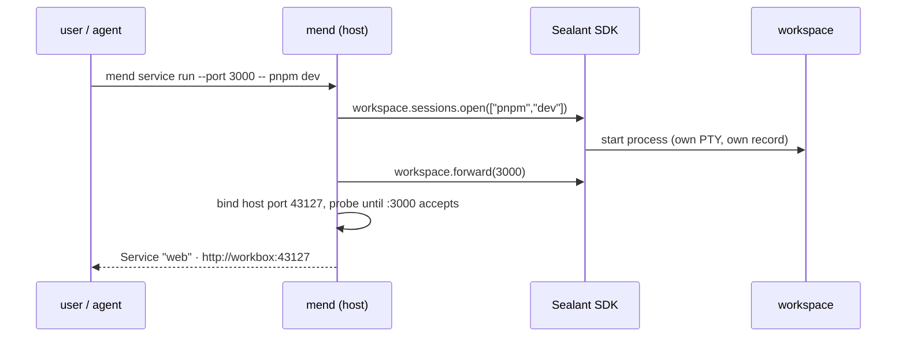

# Session Services

> **Status:** Decided architecture, amended 2026-08-21. Built: every delivery slice below.
>
> **Date:** 2026-08-12
>
> Services are explicit session capabilities exposed through raw per-port forwards on loopback and
> selected private interfaces. Previews are in [ADR 0017](adr/0017-live-preview.md), shared
> resources in [ADR 0019](adr/0019-shared-services.md), and how to use both in the public guides
> (`apps/docs/src/content/docs/guides/services.md` and `resources.md`, and
> `getting-started/try-a-preview.md`).

## What

A **Service** is a long-running process in a Mend session that the user has explicitly told Mend
about. Once declared, Mend does two things with it:

1. **Makes it reachable.** The user opens it from their laptop or phone as if it ran locally.
2. **Makes it visible.** Services appear in the CLI, web and desktop with observed state, logs, and
   Open / Restart / Stop actions. The phone shows each preview's status and opens it, with no
   Service controls.

Anything that listens on a port qualifies: a Vite dev server, a Postgres container, an Express API,
a Go binary. A Service is part of ongoing work — not a deployment, not a claim that the application
is correct.

## Why

Mend owns the session worktree and runs it inside a Sealant workspace. The user cannot open a
terminal at that worktree and run `pnpm dev`; any server they or their agent starts is trapped
inside the workspace network. That breaks the most ordinary loop in development:

```text
normal checkout                       Mend session
──────────────────────────────       ─────────────────────────────────────────
pnpm dev                             mend service run --port 3000 -- pnpm dev
open http://localhost:3000           open http://workbox:43127
```

Services restore that loop. They also answer a question no single terminal can: _what is running
right now across all my sessions?_ — one list, from any device.

## Two rules

**Explicit creation.** A recipe or user action creates a Service. Mend never scans container
internals or guesses which process owns a port. Reading project manifests in `mend service init` may
propose recipes for confirmation. A future typed listener event from the public Sealant SDK may also
produce a factual suggestion such as `Port 5173 started listening, observed`; accepting the
suggestion is still explicit. No observation creates or exposes a Service by itself.

**Private forwarding, no Mend request authentication.** A Service binds only to loopback and
explicitly selected private interfaces by default. A client elsewhere reaches a loopback-only
Service with `mend service connect`, which tunnels it through the Mend server authenticated as the
user and needs no private network; `mend attach` does the same for the attached session's browser
Services (#337). Mend adds no login or ticket in front of the raw port. The UI says that anyone who
can reach the private address can connect. Wildcard and public bindings are refused unless a later
operator policy explicitly allows them.

## The model

**A worktree is a durable named place; a session is one conversation inside it plus its record;
everything that interacts is a process** (decided 2026-08-21, amended 2026-08-31 — the worktree
became the container: many sessions per worktree, several live at once). A session has one current
workspace. Every process in it — the coding agent included — is a `session_processes` row with the
same lifecycle, one of four kinds:

| kind             | what runs                               | transport today         |
| ---------------- | --------------------------------------- | ----------------------- |
| `shell`          | the image's login shell in the worktree | PTY → `/api/tty`        |
| `agent-pty`      | `codex` / `claude` / `opencode` TUI     | PTY → `/api/tty`        |
| `agent-protocol` | `codex app-server` / claude stream-json | pipe → conversation API |
| `service`        | a recipe command (dev server, db…)      | logs + port             |

A session holds several agent processes over its life — relaunch, follow-up, resume, and protocol
turns from another device. The change is **one per worktree** (worktree vs base); every conversation
in the worktree contributes to the same change, and the checkpoint chain is the worktree's — one
dense ordinal sequence across its sessions. Harness native state (the transcript, the provider
session id a native resume addresses) is harvested **per agent process**; "the session's provider
id" means the latest agent's.

**Mode switch** (`POST /sessions/:id/handoff`, claude and codex): the same conversation moves
between `agent-pty` and `agent-protocol` — one live agent process at a time, the provider session id
the durable identity. A protocol pickup backfills PTY-era turns from the native transcript into the
durable conversation (the live adapter's own item mapping — real ids, raw blocks); a terminal pickup
resumes natively with the phone-authored turns in scrollback. `mend rejoin`/`mend resume` route
formerly-protocol sessions through it automatically.

**Session status is a fold over live processes, never a property of one process:**

```text
any agent process live                       → running
no agent live, shells or Services live       → idle
nothing live                                 → settled: completed | failed | stopped
                                                (the last agent process's outcome)
```

`waiting` stays defined but only a protocol-mode agent can report it. `starting` is a launch without
a process row yet. Stop ends the agent processes; shells and Services keep their own lifecycle, so a
stopped agent beside a live shell reads `idle` until the shell ends. That holds only for an agent
Mend started: a shell session's own shell and an observed agent are nothing to watch, so a Stop that
ends only those closes the session's shells too (a second Stop does the same after an agent).
Clients that need the agent's outcome while a shell holds the workspace read the session's
`currentAgent` (`SessionDetail.currentAgent`, the list annotation) rather than the fold.

The coding agent, supporting shells, and Services share the same worktree, dependencies, and
network. Their states remain independent: the coding-agent run can complete while a shell or Service
retains the workspace.

```text
Mend session, durable
├── coding-agent conversation and ordered runs
├── worktree and change
├── Service · web, stable identity
│   ├── attempt 1 · pnpm dev · Sealant run
│   ├── attempt 2 · pnpm dev · Sealant run
│   └── current forward · host port -> workspace port
├── Service · db, adopted port with no process attempt
└── current workspace, replaceable
    ├── agent processes (agent-pty or agent-protocol)
    ├── supporting shell processes
    └── current Service attempts
```

The stable Service, its process attempts, its host forward, and target observations are separate
facts. Restart appends an attempt and preserves prior run pointers, output, exits, and timestamps.

There are two ways to declare a Service:

| path                                       | what Mend does                                                        | typical case                             |
| ------------------------------------------ | --------------------------------------------------------------------- | ---------------------------------------- |
| `mend service run --port 3000 -- pnpm dev` | starts and supervises the command in the workspace, forwards the port | dev server, API server the user launches |
| `mend service add 5432 --name db`          | forwards an already-listening workspace port; no supervision, no logs | docker compose database, sidecar process |

That is the creation surface. Listener observations may later suggest one of these explicit actions,
but never perform it automatically.

### Declared Services in `.mend/mend.toml`

A repository declares its Services in `.mend/mend.toml`, versioned with the code so it travels to
every collaborator and session worktree. Root `mend.toml` is still read for existing repositories;
when both exist, `.mend/mend.toml` wins, with no merging (#1311;
[ADR 0019](adr/0019-shared-services.md)). The public guide
(`apps/docs/src/content/docs/guides/services.md`) is the reference for the file: every key and what
refuses it, how a recipe runs and the environment it gets, `[setup]`, resource dependencies, recipe
lookup, and `mend service init`. The CLI reference lists the commands. This section keeps only what
a maintainer needs beyond that.

A declaration is a recipe, never a running process. Mend reads the file beside the worktree when the
deployment co-locates it; otherwise it reads `/workspace/repo/.mend/mend.toml` from the session's
live workspace through the SDK's exec. With no live workspace in that mode the file is not
observable: the recipe list answers the project's recipes only, and running a file recipe is refused
with a message that says so. The session's worktree copy is authoritative, so an agent can add a
recipe as part of its change and Review shows that edit. Project recipes, the machine-local ones the
web app adds, keep their four fields: no `cwd`, `env`, `ready`, `host`, `address` or `depends`.

**Nothing autostarts.** Declaring, claiming a hot workspace, resuming and reconnecting start no
Service. Mend starts one on its own in two cases: when it replaces an executor, it starts again the
recipe Services that were running in the one it replaced, each as the person who last started it,
from the file as it reads now; and the preview after a turn, below.

**A start outlives its request.** Mend runs a start, dependencies first, to its end or to a Stop of
one of its Services, whatever happens to the request that asked for it. The request waits up to a
minute, then answers with a 504 that names the dependency still starting.
`GET /sessions/:id/services/starts/:startId` says where a start stands, recipe by recipe, for ten
minutes after it ends.

**The setup claim.** `[setup]` runs once per place and fingerprint (ADR 0017, decision 4). The
fingerprint hashes the steps, each input's bytes (or that it is absent), the workspace image's
digest, and, for an executor's copy, the executor's platform. The place is the worktree when the
deployment co-locates it, or one executor's copy in capture mode. In capture mode only an input's
sha256 leaves the workspace, never its bytes.

- The claim is in Postgres (`setup_runs`), so one start at a time runs setup in a place, across API
  processes. A start that finds another start running setup there waits for it, then reads its
  inputs again and skips setup if that run left a done stamp for what it reads now.
- A run renews its one-minute lease every 20 seconds. One whose renewal fails, or does not answer
  before its lease would lapse, stops its own processes and fails the start without a stamp. A run
  whose processes could not be confirmed stopped keeps its claim and is never stamped failed: the
  claim lapses for the next start, which stops them first, by a marker in their environment, before
  it runs setup. If the platform says the run's workspace is gone, its processes went with it. If
  the workspace cannot be reached at all, the next start waits, saying so, until the run can be
  stopped or its workspace ends. Two runs never run setup in one place at once.
- Only a run whose every step exited 0, under a claim it still held, with no Stop, is stamped done.
  A Stop that comes while the stamp is written takes it back. Only the last run in a place is kept.
- A failed setup runs again on a person's or the agent's start, never on an automatic one (an
  executor replacement's restarts, a preview's wake). An automatic start over a refused `[setup]` is
  refused too; a person's start goes on without it and says so.

**Who runs a recipe.** Any recipe runs, whoever added or changed it (ADR 0017, decision log 4,
reversed 2026-10-31). A recipe runs as the person who caused it, so nobody spends another person's
login: the person who pressed Start, a turn's sender, and for a wake whoever last started the
preview or last changed its recipe. `services.started_by` records it. A restart replays the attempt
it replaces (command, `cwd`, the recipe's `env`, `ready` and the dependencies it started with),
whoever asks, and runs no setup.

- Each runnable recipe with a command has a digest: the sha256 of `mend-recipe/v1\0` followed by the
  canonical JSON (keys sorted, no whitespace) of its `command`, `cwd`, `env`, `depends` and `setup`.
  `depends` lists each dependency's own digest, so editing `db`'s command changes the digest of a
  `web` that depends on `db`. `setup` is the `[setup]` `run` and `inputs` that a start of the recipe
  runs, or null for an adopt-only recipe. `port`, `protocol`, `browserScheme`, `host`, `address` and
  `ready` change no command, so the digest leaves them out. `GET /sessions/:id/declarations` lists
  each one with its digest.
- Migration `0170_drop_recipe_approvals` drops the approvals Mend kept before, with each attempt's
  launch source.

**The preview after a turn.** When a turn in a protocol session completes having changed the
worktree, in a project whose `.mend/mend.toml` names a `[preview]`, Mend starts that preview unless
something already runs it (ADR 0017, "After the agent is done").

- The session's latest turn decides. A turn with a later one hands its change on: the latest turn
  changed the worktree when the worktree differs from the newest checkpoint taken before the
  earliest turn it covers started, or from its base when there is none. A changed turn followed by a
  question still starts the preview, once.
- Before it reads the change, Mend asks the executor to flush its captures, up to three times, then
  reads the newest capture itself. A turn whose change cannot be read, or only from an older
  capture, records `preview not prepared · change not captured`, never "no change". Mend reads
  `.mend/mend.toml` only once a turn changed something.
- Not running: setup if its fingerprint changed, then each `depends`, then the Service, then its
  ready check, from the file as the turn left it, as the turn's sender (else the person who last
  started the Service). Running: nothing, since hot reload has the change, unless the turn changed
  the Service's command, `cwd`, `env` or `depends`; then the Service stops and starts again from the
  file. When the turn changed only `[setup]`'s inputs, the preview says
  `setup inputs changed · restart to apply`.
- A person's Stop holds, a Stop of a start whose setup still runs included: it holds on the preview
  before the Service has a row. The agent's own `mend service stop` does not hold it.
- One automatic start of a preview runs at a time, whichever session's turn began it. Under the
  lifecycle permit, just before the Service's attempt begins, Mend checks again that its claim
  holds, that no person stopped the preview, and that nothing else runs it.
- Each ended turn is decided once, by whichever API process claims it in `preview_preparations`. The
  claim is a lease that its worker renews. A worker that loses it stops where it stands and starts
  nothing more; one that dies leaves it to lapse; the next minute's pass takes the turn again. Turns
  are looked for when a conversation moves, at start-up and every minute.
- `GET /worktrees/:id/previews` returns each kept preview with its status lines, and the worktree's
  own line when its latest preparation names no kept preview. The lines are `previewStatusLine`'s,
  the same on every surface: `preview · web · answered HTTP 200 · observed 4 s ago`,
  `preview · web · starting · setup`, `preview · web · stopped by Maria`,
  `preview not prepared · web · setup failed`.

What the after-turn start leaves to other paths:

- A session that ended before its turn was prepared is not started: the line says
  `preview not prepared · session ended`. A request to the preview's address wakes it instead (ADR
  0017, delivery step 12): it resumes the workspace as `services.started_by` and starts the current
  recipe through setup and dependencies.
- A turn whose session ended while no API process was listening is never looked at: the pass reads
  only sessions that have not ended.
- Terminal sessions' turns, including history a mode switch copies in, start nothing (ADR 0017,
  delivery step 13).
- A preview started this way stops on the preview's own idle clock (`MEND_PREVIEW_IDLE`, ADR 0017
  "Delivery step 12 implementation").

## How it works

### Forwarding: one host port per Service, raw TCP

Mend allocates a host port per Service, binds it to loopback and the selected private interfaces,
and pumps bytes to the workspace port over the Sealant SDK forwarding primitive. No HTTP proxy, no
path rewriting, no header inspection.

```text
laptop / phone                     Mend (host)                        session workspace
──────────────                     ───────────                        ─────────────────
browser ────────▶ workbox:43127 ── byte pump ── workspace.forward(3000) ──▶ :3000 vite
psql ───────────▶ workbox:43128 ── byte pump ── workspace.forward(5432) ──▶ :5432 postgres
```

Raw TCP is a consequence of the requirements, not a preference:

- **Protocol-agnostic.** Postgres, gRPC, and websockets are not HTTP; a byte pump carries them all.
- **Nothing to break.** HMR, SSE, redirects, uploads, and absolute asset paths work because nothing
  inspects the stream.
- **Distinct origin for free.** One port per Service gives each web app its own browser origin, so
  repository code never runs on Mend's authenticated origin.

Two sessions can both use internal port 3000; their workspace networks are isolated and each Service
gets its own host port. The user never resolves collisions.

A friendly lookup (`session:port` → host port) can layer on later in the web UI or via local DNS; it
is presentation, not transport.

### Starting a supervised Service



`mend service run` returns as soon as the port accepts connections (or fails with the process's
output). The Service then lives independently: its own logs, its own lifecycle. It never occupies an
agent tool call.

**The agent uses the same path.** The workspace contains a scoped `mend` helper, and the harness
prompt includes one instruction:

> Use `mend service run --port <port> [--http|--https] -- <command>` for any long-running server. Do
> not background it inside a tool call.

`--http`/`--https` (on `run` and `add`) declares the browser scheme, refused with `--udp`; without
one the Service gets no Open link and no attach tunnel. The note is written into every workspace,
co-located or captured. The helper's credential permits only session-local actions (start a sibling
process, declare a port); it is not an administrator token.

### Which session?

`mend service` runs from an ordinary host terminal. Inside a workspace the injected helper is
already scoped to its own session; on the host, the CLI resolves the target in this order and never
guesses silently:

1. An explicit argument: `mend service run <session> --port 3000 -- pnpm dev`.
2. The only live session for the adopted project matching the current directory.
3. A compact interactive picker when more than one candidate remains.
4. Otherwise fail and explain — non-interactive callers never get the newest session by default.

Both interactive layers make the explicit argument cheap:

- **Dynamic shell completion.** Shipped zsh/bash/fish completions resolve `<session>` and
  `<service>` arguments live by asking the local Mend daemon (a hidden `mend __complete` command),
  so `mend service run <TAB>` offers live sessions and `mend service logs <TAB>` offers running
  Services.
- **The picker.** A small list TUI (the CLI's existing opentui stack): session name, project, agent
  state, age; type-to-filter, enter to select. The same picker backs every command that needs a
  session or Service and received none.

### Observed states

Do not collapse process, forward, and target state into one word:

```text
process     starting | running | exited | stopped | absent
forward     binding | bound | failed | closed
target      reachable | unreachable | unobserved
workspace   ready | retained | unreachable | stopped | expired
```

`reachable` means the target accepted the declared transport. It does not mean healthy, ready,
authenticated, or correct. Each observation carries its time and error when one exists. An adopted
Service has no Mend-owned process attempt, so its process state is `absent` and it has no Restart,
Stop process, or process logs action.

## Lifecycle

**Workspace leases.** The workspace stays up while any coding agent, supporting shell, Service, or
explicit temporary operation holds a live lease. A completed coding-agent run does not release other
leases. Mend renews ordinary workspace expiry while a lease remains live; if renewal fails, the UI
shows the last successful renewal and known expiry.

Leases persist and reconcile after a Mend restart. Mend reattaches to surviving processes rather
than inventing replacements — `agent-protocol` processes included since restart policy v2: the
adapter rehydrates against the surviving pipe by replaying the recorded output, and only an
unreachable pipe or a failed rehydrate ends the row (with a relaunch by provider id, not a failed
session). When the last lease ends, Mend stops the workspace promptly.

**Disconnection is not intent.** A closed browser, desktop app, dropped network, or detached CLI
stops nothing. Stops are explicit. The one exception is declared intent: with the background
sessions switch off (or `--foreground`), the launching CLI enforces foreground semantics — it stops
the session when it exits, best-effort on signals.

### Stop

Stop ends the agent processes; shells and Services keep their own lifecycle ("The model" above). A
stop keeps Services running, and a running Service keeps the workspace up, so the stop has to show
it. `liveServices` (on `SessionDetail` and the list annotation) counts the session's Services with a
live attempt or an open forward, and every surface reads it next to the agent's outcome:
`agent stopped · 3 services keep the workspace up`. The **Stop services** action
(`POST /api/sessions/:id/services/stop`, `mend stop --services`) stops all of them. Once nothing is
live, the workspace ends as it would after any last lease. Review prep does not wait for the
workspace: an agent that stopped or exited has settled for review even while Services run on.

### Resume

When supporting processes retain the workspace, resuming the coding agent starts a new run in that
workspace and leaves them intact. The user may instead choose Stop retained work and resume fresh,
with every process named before confirmation. Once no retained workspace exists, a later resume
provisions a fresh workspace around the same worktree. Services never autostart there.

## Data

Four related facts, in three tables beside the process rows (`packages/db/src/schema/workbench.ts`):

```text
services                 the stable Service
  id · sessionId · name · declarationSource · workspacePort · transport · browserScheme
  bindAddresses · preferredHostPort · currentAttemptId · currentForwardId · startedBy
  hostPolicy · address

session_processes        an attempt is a process row with serviceId and attemptOrdinal set
  sealantWorkspaceId · sealantSessionId · sealantRunId · argv · status · exitCode
  workspacePort · protocol · hostPort · reachedAt · exitedAt · runsAs
  launchCwd · launchEnv · launchReady · launchDepends   (what a restart replays)

service_forwards         one host forward
  serviceId · sealantWorkspaceId · preferredHostPort · hostPort · boundAddresses
  state · error · supersedesForwardId · boundAt · closedAt

service_observations     what a probe saw at the target, per forward
  serviceId · forwardId · state · source · error · httpStatus · firstObservedAt · lastObservedAt
```

At most one attempt of a Service is live at once (`session_processes_one_live_service_attempt_idx`).

Project-local recipes remain the machine-specific companion to repository `.mend/mend.toml` recipes.
Every client shows the recipe source. Name collisions are visible and the shadowed recipe cannot
run.

## Surfaces

```text
mend service run [session] --port <port> [--name <n>] -- <command>
mend service run [session] <name>        start a declared Service (.mend/mend.toml recipe)
mend service add [session] <port> [--name <n>]
mend service init                        scaffold .mend/mend.toml from the project's manifests
mend service list [session]
mend service connect [name…] [--port <p>]   tunnel live Services to this machine's loopback
mend service logs <service>       (supervised: attach to its PTY/record)
mend service restart <service>
mend service stop <service>
mend stop --services [session]          stop every Service of the session
```

Every surface presents the same facts:

```text
web
process running
forward bound · 127.0.0.1:43127
TCP accepted on :3000 · observed 12s ago

http://127.0.0.1:43127

[ Open ] [ Logs ] [ Restart ] [ Stop ]
```

An adopted database port instead shows `Port only, no Mend process or logs` with Copy endpoint and
Remove forward. The desktop is a control surface for the same runtime, not a separate execution
environment.

**Reaching a Service from another machine.** A loopback endpoint answers on the Mend host only. On
an instance declared `public` every Service forward stays on loopback, so a browser elsewhere cannot
open it. The web and desktop then show no Open link; they show `mend service connect <name>`
(copyable) and say that the CLI tunnels it to that machine's loopback. A private-interface endpoint
keeps Open, since a client on that network reaches it.

**Open through the preview.** On an instance whose preview gateway is on, the web Services card's
Open goes to the worktree's preview of the row's Service: `/preview-auth?preview=<id>&path=%2F` in a
new tab, which mints the ticket and redirects to the preview's origin (ADR 0017, "Where the link
shows up"). The browser never builds a preview host. The server decides the link: each preview in
`GET /worktrees/:id/previews` carries `open`, set while the gateway is on and the preview is bound,
or ended with a run a request starts (`previewOpenTarget`). Where the gateway would refuse it (an
https Service, an adopted one, one no longer browser-facing or declared), `open` is null and the row
keeps the Service's own address. Each preview also carries `boundTo`, the Service it binds and that
Service's session. A preview goes under the row of the Service it binds; one a sibling session runs
gets a row of its own, `runs in another session of this worktree`, whatever row of this session
shares its name; one that binds nothing goes under the row of its name. Until the read answers, or
while it fails, Open waits and says why, and never falls back to the Service's own address.

The card shows each preview's status under its row, worded from `facts` with `previewStatusLine` as
time passes, so `observed 4 s ago` keeps ageing on screen, and the worktree's own line below the
rows. It reads the previews again on `session-process` events, and on the `worktree` event each
phase and decision of a preparation emits. While the read says a start is under way (`starting`) it
also polls every 2 s, until the start settles, its facts stand still for 10 minutes, or 30 minutes
pass. With the gateway off, or no kept preview of the name, Open is the Service's own address, as
above.

**Preview on the phone.** The phone holds a device bearer, not Mend's cookie, so it cannot follow
`/preview-auth`. It asks `POST /previews/:id/open` instead, behind the normal auth middleware, on
every press. The server applies the same rules: the caller sees the project, signed in or paired (a
token with neither is refused), and the preview gets an Open. One function (`previewOpenOf`) decides
that Open for the previews read's `open` and for this route, so neither offers what the other
refuses. It then mints the same thirty-second, single-use `preview` ticket with the caller's
credential and answers `{ url: "<preview origin>/__mend/auth?ticket=…&path=/" }`, which the phone
opens in the in-app browser (`expo-web-browser`). The phone's web build opens a blank tab in the
press and sends it to the URL once the ticket is minted, because a browser blocks a tab opened after
the press. A refusal, or a browser that does not open, shows as one line under the header, until the
preview's Open changes. The grant it opens is the device's, so revoking the device ends it. Under
`loopback-http` routing the route refuses, since previews served at `*.localhost` reach only the
Mend machine; the previews read's `routing` says so ahead of time, and the phone shows no `Preview`
there. The session screen's `Services` lists each preview's status lines, each fact worded with the
phone's clock and the server's `status` line kept for a fact the phone does not know, in a strip
that scrolls past about four lines. The phone reads the previews again by the web's rule while a
start is under way, and every 10 s otherwise.

The CLI tunnel is one authenticated WebSocket per connection (`service-tunnel`, an upgrade ticket
each). `mend service connect` opens it on request. `mend attach`, `mend codex|claude|opencode`,
`mend rejoin`, and the dashboard open it without being asked, when the server is not the machine the
CLI runs on:

```text
laptop (mend attach)                 Mend (alpha)                 MicroVM executor
────────────────────                 ────────────                 ────────────────
browser → localhost:5173 ── tunnel ── service-tunnel socket ── workspace.forward(5173) ──▶ :5173
```

- Which Services: the attached session's live TCP Services that declare `http` or `https`. The
  dashboard's are those of the selected session, after a short dwell.
- Which port: the Service's own port when it is free on this machine, else a free one. One line
  each, `web → http://localhost:5173`. Mid-attach lines are drawn on the bottom row, and the cursor
  is put back.
- When: from `/api/events` (the session's `session-process` events), plus a re-read every 20 s. A
  Service that stops closes its tunnel. Detaching closes all of them. The Services are never stopped
  from here.
- `--no-tunnel` opts out.

`mend shell` — an interactive shell in the session's current workspace, the terminal that is not ssh
— shares all of this plumbing (concurrent processes, plural records, leases, session resolution) and
slots into the delivery order below. Its own design details (shell selection, multiplexer
integrations) stay a separate document; nothing in Services depends on them.

## Platform requirements (Sealant)

Mend consumes the platform only through the public SDK. Services rest on two capabilities:

- **Workspace port forwarding** — a duplex byte stream to a workspace port, e.g.
  `workspace.forward(port)`.
- **Concurrent processes per workspace** — verified support for multiple
  `workspace.sessions.open(argv)` processes with independent lifecycle, detach/reattach, signals,
  and exit reporting.

Nothing here requires listener observation, process-tree attribution, or Docker/runtime internals.
Typed public listener events are an optional future input for declaration suggestions only.

**Spike results (2026-08-12, SDK 0.9.0 and 0.13.1 against the deployed platform):** the shared
workspace holds. Two concurrent PTYs in one mount-sourced workspace, independent output streams,
shared filesystem, shared network (a listener opened in one PTY answers a client in the other),
independent close with the sibling unaffected, `sessions.get()` reattach, and resize all verified.
Platform gaps go to Linear.

## Delivery slices

All six slices are built. Every platform capability flows sealantd → public SDK → Mend server → CLI
→ web/phone; each slice ran that full stack.

1. **Spike: prove concurrency.** Two PTYs in one workspace via the SDK, independent detach/reattach,
   working directory, resize, signals, exit reporting.
2. **Lifecycle foundation.** Session-owned shells, plural attempts, terminal-addressed attachment,
   workspace leases, TTL renewal, and reconciliation after a Mend restart.
3. **Stable Service history.** Separate Service, attempt, forward, and target observation records;
   append attempts on restart and preserve every Sealant run pointer.
4. **Private forward policy.** Public SDK forwarding, explicit interface selection, server-resolved
   endpoints, browser-scheme declarations, endpoint movement, and read-only record logs.
5. **Dogfood in CLI and web.** Correct post-completion controls, recipe collision visibility, event
   invalidation, TCP, UDP, HMR, restart, and retained-workspace resume.
6. **Desktop and phone.** The desktop has session-nested Services with factual state and explicit
   actions (`apps/desktop/src/renderer/src/components/services-sheet.tsx`). The phone shows each
   preview's status lines under `Services` (`apps/mobile/src/components/preview-services.tsx`) and
   opens a preview, but has no Service list or Service controls.

Later changes on top of them: in capture mode a Service's `.mend/mend.toml` recipe is read from the
live workspace (#336); `mend attach`, the agent commands and the dashboard tunnel the attached
session's browser Services to the client (#337); the web and desktop show
`mend service connect <name>` where an Open link to the host's loopback would not load (#338); a
stop leaves Services running, every surface says which Services keep the workspace up, and
`mend stop --services` stops them (#368); `.mend/mend.toml` replaced root `mend.toml` as the first
place Mend reads (#1311, #1318, #1341).

## Resource runtime settings

Operators can set `MEND_RESOURCE_IDLE_STOP_SECONDS` to a positive integer number of seconds. The
default is `1800`. It sets each resource instance's idle stop bound; the data stays, and a Service
start or preview wake starts an instance stopped by idle. A person's stop still holds.

Family workspace images include Postgres and Redis clients. For a custom base, add its native client
packages to the workspace image, for example `postgresql-client` and `redis-tools` on Debian.

## Acceptance scenarios

1. The user runs `mend service run --port 3000 -- pnpm dev` and opens the app on their laptop
   without editing any configuration.
2. The agent, asked to run the app, uses the same command; the user opens the reported URL.
3. The agent edits a component; the browser receives HMR through the Service URL.
4. `mend service add 5432` makes a workspace Postgres reachable from host `psql`.
5. Two sessions both use internal port 3000 and get independent URLs.
6. The agent settles while a Service runs; the workspace survives and states are reported separately
   (`Agent · completed`, `web · reachable`).
7. A closed browser or detached CLI stops nothing; Mend restarts and reconciles the live Service.
8. The same Service opens from a phone that can reach the Service's private interface, with no login
   step.
9. On a `public` instance with MicroVM executors, `mend attach` on a laptop tunnels the agent's
   `--http` Service to `localhost:<port>`; the web shows `mend service connect <name>` rather than
   an Open link to the host's loopback.
